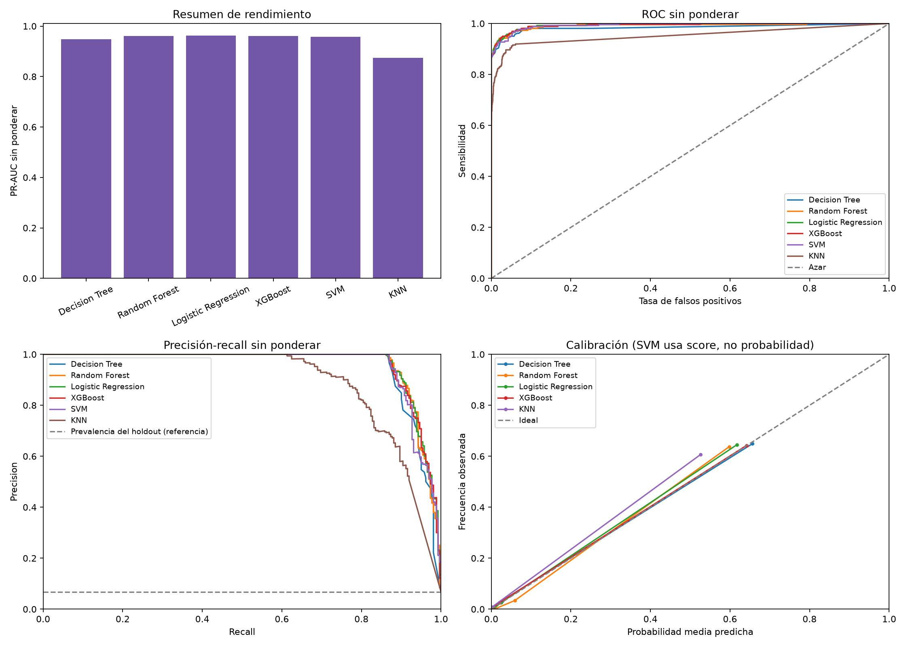

# Comparación experimental de modelos ENDES 2025

> **Experimento retrospectivo, no clínico.** D107 representa violencia severa reportada (combinación derivada de D105E/F/G). No predice feminicidio ni riesgo futuro.

## Diseño

- Elegibles con D107 observado y `V044=1`: 19,271; positivos reportados: 1,306 (6.78%, frecuencia sin ponderar). Los vacíos corresponden al patrón V501=0/V502=0; el cuestionario 2025 dirige 'Nunca casada' al ítem 1002 y no muestra un salto explícito que explique por sí solo los vacíos. No se recodifican como negativos ni se filtra por estado conyugal.
- Conglomerados: 3,229. División de holdout: 15,416 registros/2,581 conglomerados para entrenamiento y 3,855/648 para prueba.
- Prevalencia positiva sin ponderar del holdout (referencia para PR-AUC): 0.0677.
- Diseño por estrato: 240 estratos V022 observados; 46 sin positivos D107 y 122 estratos positivos con menos de cinco conglomerados. Los folds se estratifican por etiqueta y agrupan por V021; V022 no se fuerza en la partición debido a la escasez de positivos en algunas celdas.
- Semilla: `2026`. Pliegues: 3 folds agrupados y estratificados; prueba final separada por V021.
- Entradas predeclaradas: D101A-F, D103A/B/D, D105A-D, D113/D114, V012, V025, V106 y V190. Se excluyen CASEID, componentes de D107 (D105E/F/G), agregados D106/D107/D108 y variables de diseño/ponderación como predictores.
- Códigos categóricos se mantienen como categorías; desconocidos/vacíos no se convierten a ‘No’. Imputación y escalado se ajustan dentro de cada pliegue por medio del pipeline.
- Se ajusta entre dos configuraciones acotadas por modelo. Criterio de selección: PR-AUC sin ponderar en validación agrupada. El ajuste y las métricas se calculan a nivel de la muestra elegible; no son estimaciones poblacionales.
- No se aplicó sobremuestreo ni pesos de clase sintéticos; se mantuvo la prevalencia de la muestra elegible y se priorizó PR-AUC/recall al evaluar el desbalance.
- El algoritmo SVM se implementa como LinearSVC; produce un score de decisión, no probabilidades calibradas, por lo que no se calcula Brier ni se muestra en la curva de calibración.

## Selección en validación cruzada

| Modelo | Configuración | PR-AUC promedio | Desv. estándar |
|---|---:|---:|---:|
| Decision Tree | 2 | 0.9509 | 0.0033 |
| KNN | 1 | 0.8663 | 0.0223 |
| Logistic Regression | 1 | 0.9593 | 0.0047 |
| Random Forest | 1 | 0.9607 | 0.0045 |
| SVM | 1 | 0.9576 | 0.0025 |
| XGBoost | 1 | 0.9617 | 0.0044 |

## Holdout por conglomerado

Métricas sin ponderar de la muestra elegible; no representan estimaciones poblacionales corregidas por el diseño complejo.

| Modelo | Accuracy | Precision | Recall | F1 | Especificidad | ROC-AUC | PR-AUC | Brier |
|---|---:|---:|---:|---:|---:|---:|---:|---:|
| Decision Tree | 0.9909 | 1.0000 | 0.8659 | 0.9281 | 1.0000 | 0.9843 | 0.9483 | 0.0084 |
| Random Forest | 0.9909 | 1.0000 | 0.8659 | 0.9281 | 1.0000 | 0.9918 | 0.9611 | 0.0093 |
| Logistic Regression | 0.9904 | 1.0000 | 0.8582 | 0.9237 | 1.0000 | 0.9935 | 0.9623 | 0.0086 |
| XGBoost | 0.9907 | 0.9956 | 0.8659 | 0.9262 | 0.9997 | 0.9930 | 0.9609 | 0.0082 |
| SVM | 0.9909 | 1.0000 | 0.8659 | 0.9281 | 1.0000 | 0.9931 | 0.9570 | N/D (sin probabilidad) |
| KNN | 0.9764 | 0.9381 | 0.6973 | 0.8000 | 0.9967 | 0.9528 | 0.8747 | 0.0190 |

### Intervalos percentiles del 95% (bootstrap por conglomerado, 500 réplicas)

Cada réplica remuestrea conglomerados V021 completos. Este bootstrap exploratorio no estratifica por V022 ni sustituye la varianza oficial del diseño ENDES.

| Modelo | Recall | Especificidad | PR-AUC | ROC-AUC | Brier |
|---|---:|---:|---:|---:|---:|
| Decision Tree | [0.8269, 0.9045] | [1.0000, 1.0000] | [0.9258, 0.9695] | [0.9730, 0.9937] | [0.0060, 0.0111] |
| Random Forest | [0.8269, 0.9045] | [1.0000, 1.0000] | [0.9435, 0.9767] | [0.9845, 0.9968] | [0.0071, 0.0118] |
| Logistic Regression | [0.8180, 0.8995] | [1.0000, 1.0000] | [0.9453, 0.9775] | [0.9888, 0.9969] | [0.0063, 0.0113] |
| XGBoost | [0.8269, 0.9045] | [0.9991, 1.0000] | [0.9447, 0.9764] | [0.9874, 0.9967] | [0.0058, 0.0110] |
| SVM | [0.8269, 0.9045] | [1.0000, 1.0000] | [0.9382, 0.9739] | [0.9888, 0.9963] | N/D |
| KNN | [0.6314, 0.7483] | [0.9947, 0.9983] | [0.8370, 0.9082] | [0.9344, 0.9691] | [0.0158, 0.0230] |

### Confusión absoluta (umbral predeterminado)

| Modelo | TN | FP | FN | TP |
|---|---:|---:|---:|---:|
| Decision Tree | 3594 | 0 | 35 | 226 |
| Random Forest | 3594 | 0 | 35 | 226 |
| Logistic Regression | 3594 | 0 | 37 | 224 |
| XGBoost | 3593 | 1 | 35 | 226 |
| SVM | 3594 | 0 | 35 | 226 |
| KNN | 3582 | 12 | 79 | 182 |

### Rendimiento descriptivo por subgrupos del holdout

Resultados por códigos V025 (área), V106 (educación) y V190 (riqueza), con las definiciones del diccionario local. Son descriptivos; no constituyen una prueba de equidad y no incluyen intervalos de incertidumbre.

| Modelo | Variable | Código | n | D107 positivos | Recall | Especificidad | Falsos negativos |
|---|---|---:|---:|---:|---:|---:|---:|
| Decision Tree | `V025` | 1 | 2648 | 158 | 0.8608 | 1.0000 | 22 |
| Decision Tree | `V025` | 2 | 1207 | 103 | 0.8738 | 1.0000 | 13 |
| Decision Tree | `V106` | 0 | 40 | 6 | 0.8333 | 1.0000 | 1 |
| Decision Tree | `V106` | 1 | 638 | 73 | 0.9178 | 1.0000 | 6 |
| Decision Tree | `V106` | 2 | 1925 | 141 | 0.8440 | 1.0000 | 22 |
| Decision Tree | `V106` | 3 | 1252 | 41 | 0.8537 | 1.0000 | 6 |
| Decision Tree | `V190` | 1 | 1158 | 106 | 0.8774 | 1.0000 | 13 |
| Decision Tree | `V190` | 2 | 1089 | 82 | 0.8659 | 1.0000 | 11 |
| Decision Tree | `V190` | 3 | 780 | 49 | 0.8571 | 1.0000 | 7 |
| Decision Tree | `V190` | 4 | 483 | 21 | 0.8095 | 1.0000 | 4 |
| Decision Tree | `V190` | 5 | 345 | 3 | 1.0000 | 1.0000 | 0 |
| Random Forest | `V025` | 1 | 2648 | 158 | 0.8608 | 1.0000 | 22 |
| Random Forest | `V025` | 2 | 1207 | 103 | 0.8738 | 1.0000 | 13 |
| Random Forest | `V106` | 0 | 40 | 6 | 0.8333 | 1.0000 | 1 |
| Random Forest | `V106` | 1 | 638 | 73 | 0.9178 | 1.0000 | 6 |
| Random Forest | `V106` | 2 | 1925 | 141 | 0.8440 | 1.0000 | 22 |
| Random Forest | `V106` | 3 | 1252 | 41 | 0.8537 | 1.0000 | 6 |
| Random Forest | `V190` | 1 | 1158 | 106 | 0.8774 | 1.0000 | 13 |
| Random Forest | `V190` | 2 | 1089 | 82 | 0.8659 | 1.0000 | 11 |
| Random Forest | `V190` | 3 | 780 | 49 | 0.8571 | 1.0000 | 7 |
| Random Forest | `V190` | 4 | 483 | 21 | 0.8095 | 1.0000 | 4 |
| Random Forest | `V190` | 5 | 345 | 3 | 1.0000 | 1.0000 | 0 |
| Logistic Regression | `V025` | 1 | 2648 | 158 | 0.8481 | 1.0000 | 24 |
| Logistic Regression | `V025` | 2 | 1207 | 103 | 0.8738 | 1.0000 | 13 |
| Logistic Regression | `V106` | 0 | 40 | 6 | 0.8333 | 1.0000 | 1 |
| Logistic Regression | `V106` | 1 | 638 | 73 | 0.9178 | 1.0000 | 6 |
| Logistic Regression | `V106` | 2 | 1925 | 141 | 0.8298 | 1.0000 | 24 |
| Logistic Regression | `V106` | 3 | 1252 | 41 | 0.8537 | 1.0000 | 6 |
| Logistic Regression | `V190` | 1 | 1158 | 106 | 0.8679 | 1.0000 | 14 |
| Logistic Regression | `V190` | 2 | 1089 | 82 | 0.8659 | 1.0000 | 11 |
| Logistic Regression | `V190` | 3 | 780 | 49 | 0.8367 | 1.0000 | 8 |
| Logistic Regression | `V190` | 4 | 483 | 21 | 0.8095 | 1.0000 | 4 |
| Logistic Regression | `V190` | 5 | 345 | 3 | 1.0000 | 1.0000 | 0 |
| XGBoost | `V025` | 1 | 2648 | 158 | 0.8608 | 0.9996 | 22 |
| XGBoost | `V025` | 2 | 1207 | 103 | 0.8738 | 1.0000 | 13 |
| XGBoost | `V106` | 0 | 40 | 6 | 0.8333 | 1.0000 | 1 |
| XGBoost | `V106` | 1 | 638 | 73 | 0.9178 | 1.0000 | 6 |
| XGBoost | `V106` | 2 | 1925 | 141 | 0.8440 | 1.0000 | 22 |
| XGBoost | `V106` | 3 | 1252 | 41 | 0.8537 | 0.9992 | 6 |
| XGBoost | `V190` | 1 | 1158 | 106 | 0.8774 | 1.0000 | 13 |
| XGBoost | `V190` | 2 | 1089 | 82 | 0.8659 | 1.0000 | 11 |
| XGBoost | `V190` | 3 | 780 | 49 | 0.8571 | 1.0000 | 7 |
| XGBoost | `V190` | 4 | 483 | 21 | 0.8095 | 0.9978 | 4 |
| XGBoost | `V190` | 5 | 345 | 3 | 1.0000 | 1.0000 | 0 |
| SVM | `V025` | 1 | 2648 | 158 | 0.8608 | 1.0000 | 22 |
| SVM | `V025` | 2 | 1207 | 103 | 0.8738 | 1.0000 | 13 |
| SVM | `V106` | 0 | 40 | 6 | 0.8333 | 1.0000 | 1 |
| SVM | `V106` | 1 | 638 | 73 | 0.9178 | 1.0000 | 6 |
| SVM | `V106` | 2 | 1925 | 141 | 0.8440 | 1.0000 | 22 |
| SVM | `V106` | 3 | 1252 | 41 | 0.8537 | 1.0000 | 6 |
| SVM | `V190` | 1 | 1158 | 106 | 0.8774 | 1.0000 | 13 |
| SVM | `V190` | 2 | 1089 | 82 | 0.8659 | 1.0000 | 11 |
| SVM | `V190` | 3 | 780 | 49 | 0.8571 | 1.0000 | 7 |
| SVM | `V190` | 4 | 483 | 21 | 0.8095 | 1.0000 | 4 |
| SVM | `V190` | 5 | 345 | 3 | 1.0000 | 1.0000 | 0 |
| KNN | `V025` | 1 | 2648 | 158 | 0.6582 | 0.9976 | 54 |
| KNN | `V025` | 2 | 1207 | 103 | 0.7573 | 0.9946 | 25 |
| KNN | `V106` | 0 | 40 | 6 | 0.6667 | 1.0000 | 2 |
| KNN | `V106` | 1 | 638 | 73 | 0.7945 | 0.9929 | 15 |
| KNN | `V106` | 2 | 1925 | 141 | 0.6596 | 0.9966 | 48 |
| KNN | `V106` | 3 | 1252 | 41 | 0.6585 | 0.9983 | 14 |
| KNN | `V190` | 1 | 1158 | 106 | 0.7170 | 0.9943 | 30 |
| KNN | `V190` | 2 | 1089 | 82 | 0.7683 | 0.9970 | 19 |
| KNN | `V190` | 3 | 780 | 49 | 0.6122 | 0.9973 | 19 |
| KNN | `V190` | 4 | 483 | 21 | 0.5714 | 0.9978 | 9 |
| KNN | `V190` | 5 | 345 | 3 | 0.3333 | 1.0000 | 2 |

## Lectura responsable

En esta corrida, XGBoost obtuvo el mayor PR-AUC medio de validación agrupada (0.9617) y Logistic Regression el mayor PR-AUC del holdout (0.9623). Las diferencias son pequeñas y provienen de una única partición final; no bastan para elegir un modelo generalizable. Logistic Regression tuvo 37 falsos negativos entre 261 positivos observados en el holdout, bajo el umbral predeterminado.

El algoritmo con el mayor PR-AUC observado en este único holdout no se declara modelo ganador para uso real. La comparación no constituye validación externa, evaluación de calibración por diseño muestral ni validación clínica. Los falsos negativos son errores de clasificación de D107 retrospectivo y no estiman falsos negativos de feminicidio futuro.

La encuesta es transversal y no tiene desenlace individual posterior ni horizonte temporal para feminicidio. Diagnóstico para predicción futura: **NO APTO con ENDES 2025 sola**. El experimento de D107 es **APTO CON LIMITACIONES** únicamente como clasificación retrospectiva exploratoria.

## Limitaciones y siguientes validaciones

- D107 es violencia severa reportada en la encuesta; no feminicidio ni evento futuro.
- La elegibilidad requiere D107 observado y V044=1. Los vacíos de D107 coinciden con V501=0/V502=0 (nunca casada); el cuestionario 2025 dirige ese estado al ítem 1002 y no muestra un salto que por sí solo explique los vacíos. No se presume que sean negativos ni se usan V501/V502 como filtros.
- Entre D107 observado y V044=1, D114 solo está vacío cuando D113=0; se conserva como categoría faltante y no se convierte en el código 0 ('Nunca'). La API experimental valida esta relación condicional.
- El análisis usa métricas y ajuste sin ponderar, a nivel de la muestra elegible; no produce estimaciones poblacionales ni inferencia oficial del diseño ENDES.
- La ficha ENDES 2024 del indicador de violencia especifica V005/1,000,000 salvo en 2020; el informe PPR del primer semestre 2025 documenta V005 para indicadores de mujeres y reporta resultados de violencia. No se encontró una especificación 2025 directa para D107 y la elegibilidad exacta V044=1. Por ello, el experimento conserva métricas sin ponderar, no hace estimaciones poblacionales y deja cualquier análisis con V005 como sensibilidad metodológica separada.
- El holdout se separa por V021, pero esto no reemplaza una estimación completa de varianza del diseño complejo.
- Los intervalos son bootstrap percentil por conglomerado sin respetar V022; son exploratorios y no son intervalos oficiales del diseño ENDES.
- V022 se analizó pero no se usó para estratificar los folds: hay estratos sin positivos y numerosas celdas positivas con menos de cinco conglomerados.
- Los resultados son exploratorios, una sola encuesta/año, sin validación externa ni instrumento equivalente a las 12 preguntas del producto.
- Los umbrales de clasificación son los predeterminados; no se ajustaron para optimizar decisiones clínicas.
- Se requiere documentar elegibilidad y saltos del cuestionario con el manual completo, verificar la unidad de análisis, e incorporar inferencia de encuesta (estratos, conglomerados y pesos) con un especialista en muestreo.
- Se requiere validación temporal o externa independiente antes de afirmar generalización; para feminicidio futuro hacen falta datos longitudinales enlazados con desenlace y fecha, además de protocolo ético/legal.
- Las 12 preguntas del producto no son equivalentes a estas variables ENDES y no se deben enviar a estos modelos.
- Se guarda el candidato de mejor PR-AUC CV como artefacto local ignorado por Git (`artifacts/endes-2025-d107-research-candidate-v1.joblib`) con metadatos (`artifacts/endes-2025-d107-research-candidate-v1.json`). Se reentrena con todas las filas elegibles después de la evaluación, pero no se selecciona para el producto ni se habilita como predictor de feminicidio.
- No se guarda dataset procesado ni identificadores; el artefacto solo se puede reproducir con el ZIP original local protegido por `.gitignore`.

Fuentes: INEI ENDES 2025 ficha técnica y diccionario REC84DV, referenciados en [`data_audit.md`](data_audit.md).
